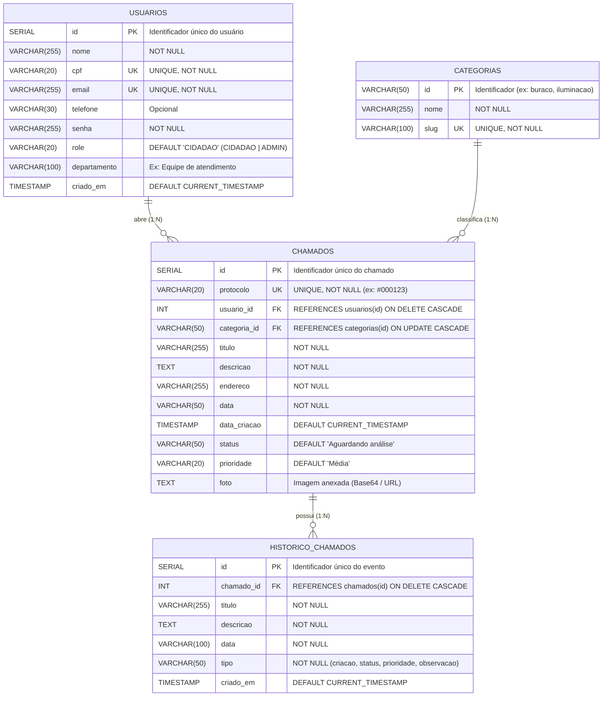

# Modelagem de Banco de Dados — Alô Prefeitura 🏛️

Este documento descreve o modelo de dados relacional projetado para o sistema **Alô Prefeitura**, contemplando suas entidades, atributos, tipos de dados, relacionamentos e restrições de integridade (*constraints*).

---

## 1. Diagrama Entidade-Relacionamento (DER)

---

## 2. Descrição das Entidades

1. **`usuarios`**: Armazena os dados cadastrais e credenciais de autenticação tanto dos cidadãos moradores do município (`role = 'CIDADAO'`) quanto dos funcionários responsáveis pelo atendimento (`role = 'ADMIN'`).
2. **`categorias`**: Catálogo padronizado de tipos de problemas urbanos atendidos pela prefeitura (ex.: *Buraco na via*, *Iluminação pública*, *Descarte irregular de lixo*, *Árvore caída*).
3. **`chamados`**: Entidade central do sistema que registra cada ocorrência aberta pelo cidadão, contendo número de protocolo único, localização, descrição, foto anexada, status atual e nível de prioridade.
4. **`historico_chamados`**: Registra a linha do tempo completa de cada chamado desde sua abertura até a resolução, incluindo alterações de status, mudanças de prioridade e observações técnicas inseridas pela equipe da prefeitura.

---

## 3. Relacionamentos e Cardinalidades

- **`usuarios` (1) ↔ (N) `chamados`**: Um usuário (cidadão) pode registrar zero ou vários chamados (`0..N`), enquanto cada chamado é aberto obrigatoriamente por um único usuário (`1..1`).
- **`categorias` (1) ↔ (N) `chamados`**: Uma categoria pode classificar zero ou vários chamados (`0..N`), enquanto cada chamado pertence a uma única categoria (`1..1`).
- **`chamados` (1) ↔ (N) `historico_chamados`**: Um chamado possui um ou vários registros de histórico (`1..N`), e cada registro de histórico pertence exclusivamente a um chamado (`1..1`).

---

## 4. Restrições de Integridade (*Constraints*)

- **Integridade de Entidade (`PRIMARY KEY`)**: Todas as tabelas possuem chave primária definida (`id`).
- **Integridade Referencial (`FOREIGN KEY`)**:
  - `chamados.usuario_id` referencia `usuarios(id)` com `ON DELETE CASCADE`.
  - `chamados.categoria_id` referencia `categorias(id)` com `ON UPDATE CASCADE`.
  - `historico_chamados.chamado_id` referencia `chamados(id)` com `ON DELETE CASCADE` (garantindo que a exclusão de um chamado remova automaticamente seu histórico associado).
- **Integridade de Unicidade (`UNIQUE`)**:
  - Não são permitidos cadastros duplicados de `cpf` ou `email` na tabela `usuarios`.
  - Cada ocorrência possui um código de `protocolo` exclusivo na tabela `chamados`.
- **Integridade de Domínio (`CHECK` e `NOT NULL`)**:
  - `usuarios.role` aceita apenas `'CIDADAO'` ou `'ADMIN'`.
  - `chamados.status` aceita apenas `'Aberto'`, `'Aguardando análise'`, `'Em análise'`, `'Em atendimento'` ou `'Resolvido'`.
  - `chamados.prioridade` aceita apenas `'Baixa'`, `'Média'` ou `'Alta'`.
